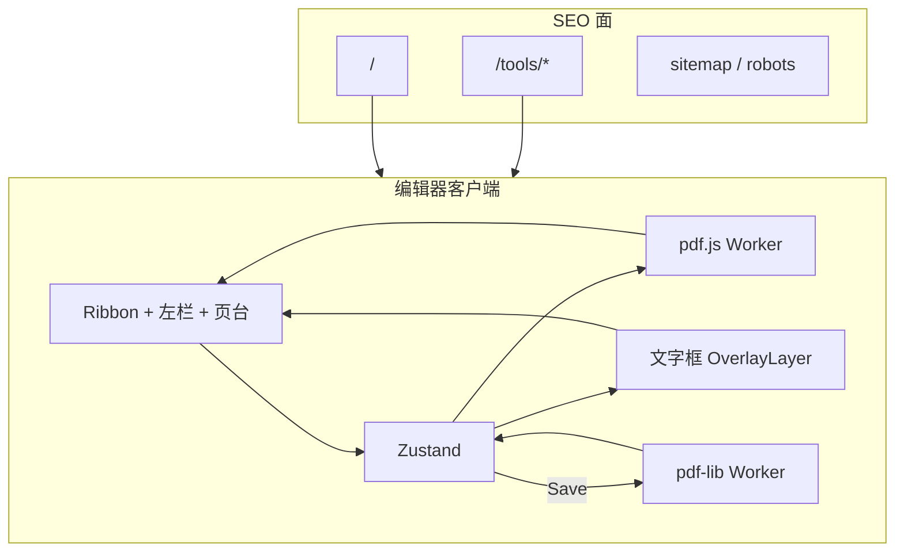

# 架构设计

## 系统概述

系统分两面：SEO 落地页由 Next.js 服务端输出 HTML；编辑器是 `/editor` 上的客户端工作台。PDF 的解析、渲染、叠加、导出都在浏览器里完成。叠加层是编辑过程的源；保存成功后，bake 结果成为新的源文档。

## 技术栈

- Next.js 15 App Router, React 19, TypeScript
- Tailwind CSS
- Zustand
- pdfjs-dist（Worker 渲染）
- pdf-lib, @pdf-lib/fontkit（Worker 写回）
- react-konva, Konva
- dnd-kit（书签树）
- Playwright（e2e）

## 项目结构（建议）

```
app/
  layout.tsx
  page.tsx
  robots.ts
  sitemap.ts
  editor/page.tsx
  tools/pdf-editor/page.tsx
  tools/pdf-bookmark/page.tsx
  tools/pdf-sign/page.tsx
  tools/pdf-highlight/page.tsx
components/landing/
components/editor/
lib/pdf/
lib/store/
lib/seo/
public/cmaps/
public/fonts/
```

## 核心模块/组件

| 模块 | 职责 |
|------|------|
| Landing pages | 服务端 HTML、标题、描述、CTA 进入编辑器 |
| EditorWorkspace | Ribbon、左栏、页台、状态栏 |
| documentStore | 文档字节、叠加对象、书签、选中、撤销 |
| pdfRenderWorker | 打开、按页渲染、缩略图、Outline、文本层 |
| OverlayLayer | 文字框 CRUD 与拖拽缩放（当前为 DOM 叠加，后续接 Konva） |
| BookmarkPanel | 树展示、拖拽、跳转 |
| pdfBakeWorker | 把叠加对象画进页面并写出 Outline |
| pageMetrics | PDF 用户空间与 CSS 像素互转 |

## 架构图



## 关键流程

### 打开文档

1. User 选择或拖入 PDF
2. 主线程把 ArrayBuffer transfer 给 pdfRenderWorker
3. Worker 返回页数、页尺寸、Outline
4. Store 写入 DocumentState，第一页进入 Viewport
5. 可见页渲染 canvas，缩略图按需生成

### 即时编辑

1. 「添加文字」工具在 Page 上点击创建文字框，随后可拖拽、缩放、改样式
2. Store 提交 mutation，推入撤销栈
3. OverlayLayer 用新 props 绘制，下一动画帧可见
4. 源 PDF 字节此时保持不变

### 保存导出

1. User 点 Save
2. Store 把 sourceBytes、overlays、bookmarks transfer 给 pdfBakeWorker
3. Worker embed 字体/图片，draw 到对应页，写 Outline，返回 bytes
4. 浏览器下载 `{name}-edited.pdf`
5. Store 用新 bytes 重载预览，已 bake 的 overlay 清空

### 书签写回

1. 内存树保持 title、pageIndex、children
2. Bake 时按先序写出 `/Outlines`，目标为 `[pageRef, /Fit]`
3. 再次打开时 PDF.js `getOutline()` 还原同一棵树

## 设计决策

1. 落地页 SSR，编辑器 CSR，文件不上传。
2. PDF.js 负责看，pdf-lib 负责改，叠加层负责交互。
3. 第一期只做叠加编辑，原文内容流保持原样。
4. 视图旋转第一期只改显示。
5. 会话内存，刷新回到空状态。
6. CJK 文本 bake 时嵌入 Noto 子集。
