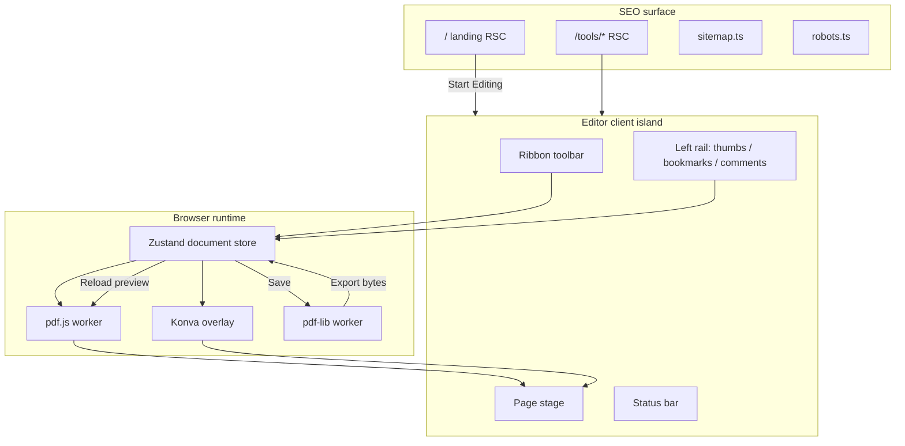
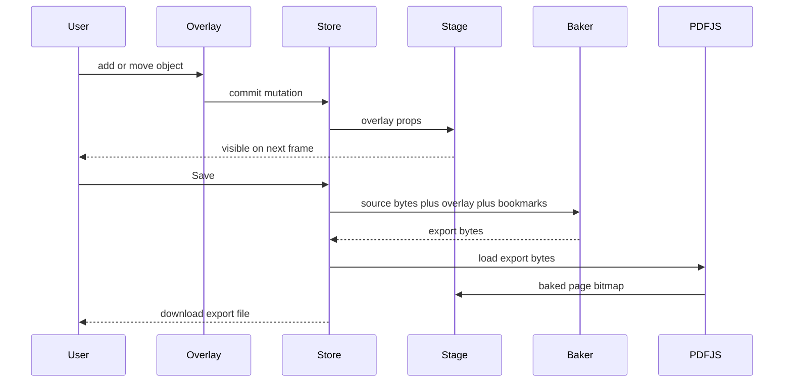

# Online PDF Editor

Feature Name: online-pdf-editor
Updated: 2026-11-07

## Description

Phase 1 delivers a Foxit-style browser PDF editor. Marketing pages are server-rendered for SEO. The editor runs entirely in the client: PDF.js paints page bitmaps, a Konva overlay hosts live objects, and pdf-lib bakes those objects plus the bookmark tree into a downloadable PDF. Edits appear on the current page on the next animation frame. Bake happens on Save / Save As.

This design covers Phase 1 requirements in `.monkeycode/specs/2026-11-07-online-pdf-editor/requirements.md`.

## Architecture

The application is a Next.js App Router project with two rendering surfaces:

- Landing routes are React Server Components with Metadata API.
- `/editor` is a client island. PDF bytes never leave the tab.



### Runtime split

| Concern | Runtime | Library |
|---|---|---|
| Landing HTML, titles, sitemap | Server | Next.js Metadata API |
| File open, page render | Client Worker | pdfjs-dist |
| Overlay CRUD, drag, zoom | Client main thread | react-konva |
| Bookmark tree UI | Client main thread | React + dnd-kit |
| Bake overlay + outline | Client Worker | pdf-lib, @pdf-lib/fontkit |
| Undo / redo | Client main thread | Zustand temporal stack |

### Data flow: edit then preview



## Components and Interfaces

### Route map

| Route | Type | SEO | Role |
|---|---|---|---|
| `/` | RSC | index | Product home |
| `/tools/pdf-editor` | RSC | index | Editor capability page |
| `/tools/pdf-bookmark` | RSC | index | Bookmark capability page |
| `/tools/pdf-sign` | RSC | index | Signature capability page |
| `/tools/pdf-highlight` | RSC | index | Highlight capability page |
| `/editor` | Client | noindex | Workspace |
| `/sitemap.xml` | Metadata route | - | Landing URLs |
| `/robots.txt` | Metadata route | - | Allow landings, disallow `/editor` |

### Editor shell

```
EditorWorkspace
├── Ribbon
│   ├── FileGroup
│   ├── ViewGroup
│   ├── EditGroup
│   ├── CommentGroup
│   ├── SignGroup
│   └── BookmarkGroup
├── LeftRail
│   ├── ThumbnailPanel
│   ├── BookmarkPanel
│   └── CommentPanel
├── PageStage
│   ├── PdfPageCanvas          pdf.js canvas per visible page
│   ├── OverlayLayer           Konva stage aligned to page CSS size
│   └── TextSelectionLayer     pdf.js text layer, used for bookmark title
└── StatusBar
```

### Overlay model

All overlay coordinates use PDF user space of the target page (origin bottom-left, unit point). Konva works in CSS pixels with origin top-left. `pageMetrics.ts` converts:

- `pdfToCss(x, y, pageWidth, pageHeight, scale, viewRotation)`
- `cssToPdf(x, y, pageWidth, pageHeight, scale, viewRotation)`

Phase 1 view rotation is a display-only transform. Bake uses unrotated page coordinates.

### Bookmark model

Bookmark tree is an ordered forest. Each node:

- `id`: session UUID
- `title`: string
- `pageIndex`: 0-based
- `children`: Bookmark[]

On open, `outlineReader` maps PDF.js `getOutline()` into this forest. On bake, `outlineWriter` writes `/Outlines` via pdf-lib, emitting `/Dest` arrays of the form `[pageRef, /Fit]`.

### Worker contracts

`pdfRenderWorker`

- `init({ data: ArrayBuffer }) -> { pageCount, pageSizes }`
- `renderPage({ pageIndex, scale }) -> { imageBitmap }`
- `renderThumb({ pageIndex }) -> { imageBitmap }`
- `getOutline() -> OutlineNode[]`
- `getTextContent({ pageIndex }) -> TextItem[]`

`pdfBakeWorker`

- `bake({ source: ArrayBuffer, overlays: OverlayObject[], bookmarks: Bookmark[] }) -> { bytes: Uint8Array }`

Large ArrayBuffers transfer with `postMessage(..., [buffer])` to avoid copies.

### Public editor commands

The store exposes command functions used by Ribbon and keyboard maps:

- `openFile(file: File)`
- `closeDocument()`
- `setZoom(mode: 'width' | 'page' | number)`
- `goToPage(pageIndex: number)`
- `addTextBox(pageIndex, pdfPoint)`
- `insertImage(pageIndex, file)`
- `placeSignature(pageIndex, signatureId)`
- `addHighlight(pageIndex, pdfRect, color)`
- `addBookmark({ afterId?, title?, pageIndex })`
- `renameBookmark(id, title)`
- `deleteBookmark(id)`
- `moveBookmark(id, parentId, index)`
- `setBookmarkDest(id, pageIndex)`
- `exportPdf()`
- `undo()` / `redo()`

## Data Models

```ts
type OverlayType = 'text' | 'image' | 'signature' | 'highlight'

interface Rect {
  x: number
  y: number
  width: number
  height: number
}

interface OverlayBase {
  id: string
  type: OverlayType
  pageIndex: number
  rect: Rect
}

interface TextBox extends OverlayBase {
  type: 'text'
  content: string
  fontFamily: 'NotoSansSC' | 'NotoSerifSC' | 'Helvetica'
  fontSize: number
  color: string
  align: 'left' | 'center' | 'right'
}

interface ImageObject extends OverlayBase {
  type: 'image'
  mime: 'image/png' | 'image/jpeg'
  bytes: Uint8Array
}

interface SignatureObject extends OverlayBase {
  type: 'signature'
  signatureId: string
  bytes: Uint8Array
}

interface HighlightObject extends OverlayBase {
  type: 'highlight'
  color: 'yellow' | 'green' | 'pink' | 'blue'
  opacity: 0.4
}

interface Bookmark {
  id: string
  title: string
  pageIndex: number
  children: Bookmark[]
}

interface DocumentState {
  name: string
  sourceBytes: Uint8Array
  exportBytes: Uint8Array | null
  pageCount: number
  pageSizes: { width: number; height: number }[]
  overlays: OverlayBase[]
  bookmarks: Bookmark[]
  signatures: { id: string; bytes: Uint8Array }[]
}
```

Undo stores patches of `overlays` and `bookmarks` only. Source bytes stay outside the history stack.

## Correctness Properties

- Overlay screen position and baked PDF position differ by at most 1 PDF point after round-trip through `pdfToCss` then `cssToPdf`.
- Bookmark tree sibling order and depth after bake match the in-memory tree when re-read by PDF.js `getOutline()`.
- Highlight bake uses a transparent fill; original page content under the highlight remains readable.
- Chinese text bake embeds the chosen Noto font subset; Helvetica uses pdf-lib StandardFonts.
- Image and signature bake preserve aspect ratio of the overlay rect.
- Deleting a bookmark deletes the whole subtree in memory and in the baked Outline.
- Undo of a bake-reload restores overlay objects; the preview canvas follows the restored overlay set.
- `/editor` HTML includes `noindex`. Landing pages each have a distinct title and description.

## Error Handling

| Scenario | Handling |
|---|---|
| Non-PDF or corrupt file | Toast with parser message; keep previous document |
| Image over 10 MB or wrong type | Toast; no object created |
| pdf.js render failure on one page | Show page-error placeholder; other pages keep rendering |
| pdf-lib bake failure | Toast; overlays stay editable; last preview remains |
| Browser memory pressure on files above 50 MB | Warn before open; proceed if User confirms |
| Missing CMap / font for preview | Fall back to pdf.js built-in; bake still embeds Noto for new text |
| Worker crash | Recreate worker, reload current sourceBytes, preserve overlay state |

User-visible errors use a single `AppToast` region. Messages name the action and the cause.

## Test Strategy

### Unit

- `pageMetrics` conversion round-trip
- Bookmark forest insert / delete-subtree / move
- Undo stack cap at 50 and redo clear-on-new-mutation
- Outline reader / writer mapping
- Filename `{original}-edited.pdf`

### Integration (jsdom + worker stubs)

- Open sample PDF → pageCount and outline match fixtures
- Add text / image / highlight / signature → store contains expected objects
- Bake fixture → PDF.js re-opens and `getOutline()` matches
- Highlight comment list click → `goToPage` called with that pageIndex

### Visual / e2e (Playwright)

- Landing pages return 200 with expected `<h1>` and meta description
- `/editor` meta robots contains `noindex`
- Drop fixture PDF, add a text box, assert canvas overlay text is visible before Save
- Save downloads a PDF; re-open in editor shows baked text on the page bitmap
- Bookmark add, nest, rename, delete, jump

### Fixtures

- `blank-a4.pdf`
- `outline-nested.pdf` (two-level Foxit-exported outline)
- `scanned-image-page.pdf`
- `cjk-text.pdf`

## Project Structure

```
app/
  layout.tsx
  page.tsx
  robots.ts
  sitemap.ts
  editor/page.tsx
  tools/pdf-editor/page.tsx
  tools/pdf-bookmark/page.tsx
  tools/pdf-sign/page.tsx
  tools/pdf-highlight/page.tsx
components/
  landing/
  editor/
    EditorWorkspace.tsx
    ribbon/
    panels/
    stage/
lib/
  pdf/pageMetrics.ts
  pdf/outline.ts
  pdf/renderWorker.ts
  pdf/bakeWorker.ts
  store/documentStore.ts
  seo/metadata.ts
public/
  cmaps/
  fonts/NotoSansSC.ttf
  fonts/NotoSerifSC.ttf
```

## Design Decisions

1. **Client bake, server SEO.** Search needs HTML. PDF bytes stay in the tab. The two surfaces share a layout chrome and split at `/editor`.
2. **PDF.js for view, pdf-lib for write.** PDF.js is the proven renderer. pdf-lib mutates the object graph without rasterizing whole pages, so search, vector text, and existing outline survive except where overlays cover pixels.
3. **Overlay-first editing.** Phase 1 adds content on top of pages. In-place rewrite of original text operators is a Phase 3 problem.
4. **Konva over raw DOM.** Drag handles, hit testing, and multi-object selection stay in one scene graph aligned to each page canvas.
5. **Session memory only.** Phase 1 has no account or server store. Refresh returns to empty state.
6. **View rotation display-only.** Writing `/Rotate` changes object coordinates for later bakes; Phase 2 will bake rotation with page organize.
7. **Noto embedding.** Standard 14 fonts lack CJK. Bake of Noto Sans SC / Noto Serif SC uses fontkit subsetting.

## Error Handling Summary for Bake vs Preview

Preview overlay is the source of truth until Save. After a successful bake, `exportBytes` become the new `sourceBytes`, overlays that were baked are cleared, and bookmarks remain as the tree already written. If the User edits again, new overlays accumulate on the baked base.

## References

[^1]: Mozilla PDF.js - viewer and outline API
[^2]: pdf-lib - page drawing, embed font, outline
[^3]: Foxit Reader bookmark panel - add, nest, rename, delete subtree, set destination
[^4]: Next.js Metadata API, sitemap, robots
